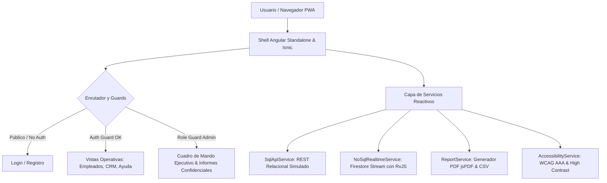

# NexusERP Pro - Sistema de Gestión Multiplataforma (PWA/Híbrida)

**Módulo Profesional:** Desarrollo de Interfaces (Código: 0488)  
**Ciclo Formativo:** Grado Superior en Desarrollo de Aplicaciones Multiplataforma (DAM)  
**Autor:** Diego Verdaguer Sebastián  
**Centro:** Universidad Nebrija  
**Tecnologías:** Ionic Framework 9, Angular 22 (Standalone), TypeScript 6, Chart.js, jsPDF, RxJS  
**URL de Producción:** [https://nexus-erp-ionic-pwa.vercel.app](https://nexus-erp-ionic-pwa.vercel.app)  
**Repositorio GitHub:** [https://github.com/dverdaguersebastian/nexus-erp-ionic-pwa](https://github.com/dverdaguersebastian/nexus-erp-ionic-pwa)

---

## 1. Descripción General del Proyecto

**NexusERP Pro** es una plataforma de gestión empresarial concebida bajo arquitectura desacoplada, declarativa y reactiva. Integra consumo concurrente asíncrono desde dos orígenes de persistencia (SQL relacional y NoSQL documental en tiempo real), control de acceso granular por roles (RBAC), componentes visuales agnósticos y reutilizables, analítica interactiva y un cumplimiento riguroso de las pautas de accesibilidad **WCAG 2.1 AA/AAA**.



---

## 2. Credenciales de Acceso para Evaluación

| Rol | Correo Electrónico | Contraseña | Permisos y Alcance |
| :--- | :--- | :--- | :--- |
| **Administrador** | `admin@empresa.com` | `admin123` | Acceso irrestricto al Cuadro de Mando (Chart.js), borrado de personal, auditoría y exportación de informes confidenciales. |
| **Usuario Estándar** | `empleado@empresa.com` | `user123` | Acceso operativo: Directorio de empleados (modo lectura), cartera de clientes CRM y canal de ayuda. Rutas `/dashboard` y `/reports` bloqueadas con 403. |

> **Nota:** La pantalla de inicio de sesión incorpora botones de un solo clic para cargar automáticamente cualquiera de los dos perfiles de prueba.

---

## 3. Arquitectura y Fases Evaluables

### Fase 1: Estructuración y Renderizado Declarativo (RA 1 y RA 2)
- **Sistema de Enrutamiento:** Enrutamiento modular con Lazy Loading en todas las vistas mediante `loadComponent: () => import(...)`.
- **Protección de Rutas (Guards):**
  - `authGuard`: Valida la existencia y vigencia de la sesión mediante comprobación de token JWT.
  - `roleGuard`: Restringe rutas ejecutivas (`/dashboard`, `/reports`) exclusivamente al perfil `admin`. Redirige intentos no autorizados a la vista `/unauthorized` (403).
- **Manejo Asíncrono de Tokens:** Generación y verificación de token JWT Bearer injectado transparentemente en peticiones mediante `authInterceptor`.
- **Formularios Reactivos y Validaciones Asíncronas:**
  - `uniqueEmailValidator`: Consulta asíncrona al servicio backend con `timer(350)` y `switchMap` para certificar la disponibilidad del correo en tiempo real.
  - `uniqueEmployeeCodeValidator`: Verificación de unicidad del identificador corporativo `EMP-XXX`.
  - Gestión avanzada de UX con estados `PENDING` (indicador de carga animado), `VALID` (confirmación verde) y `INVALID` (mensaje contextual de error).

### Fase 2: Componentización Visual y Lógica de Negocio (RA 3)
Se han desarrollado dos componentes visuales agnósticos y reutilizables, optimizados mediante `ChangeDetectionStrategy.OnPush` y Signals:
1. **`AdvancedDataTableComponent` (`<app-advanced-data-table>`)**:
   - Agnóstico de datos: Recibe columnas (`columns`), filas (`data`) y opciones de configuración por `@Input()`.
   - Buscador reactivo integrado con `debounceTime(250)` y `distinctUntilChanged()`.
   - Ordenación bidireccional por cabeceras de columna con indicadores visuales y atributos WAI-ARIA `aria-sort`.
   - Paginador interactivo con recuento de registros.
   - Emisión desacoplada de eventos al padre mediante `@Output() rowClick` y `@Output() actionClick`.
   - Prevención de fugas de memoria con desuscripción estricta en `ngOnDestroy`.
2. **`StatWidgetComponent` (`<app-stat-widget>`)**:
   - Tarjeta métrica KPI con valor, porcentaje de tendencia (+/-), periodo de comparación e icono.
   - Variantes de color accesibles (primary, success, warning, danger).
   - Evento desacoplado `@Output() cardClick` al pulsar sobre el indicador.
3. **`HelpGuideComponent` (`<app-help-guide>`)**:
   - Componente de ayuda embebida y manual de usuario interactivo en tiempo de ejecución.

### Fase 3: Consumo de Datos y Generación de Informes (RA 5)
- **Consumo Dual de Persistencia:**
  - **SQL Relacional (`SqlApiService`)**: Simula endpoints REST sobre base de datos relacional con modelos normalizados (Empleados, Departamentos con relaciones foráneas y facturación agregada).
  - **NoSQL Documental en Tiempo Real (`NoSqlRealtimeService`)**: Simula una colección de documentos Firestore con un flujo reactivo `BehaviorSubject` que emite eventos de auditoría y telemetría de clúster cada 25 segundos sin refrescar el navegador.
- **Orquestación Asíncrona:** Empleo de `forkJoin` para consolidar de forma concurrente el conjunto de métricas antes del renderizado de gráficos.
- **Cuadro de Mando Ejecutivo (Chart.js):**
  - Gráfico combinado de barras y líneas para Facturación vs Gastos vs Objetivos.
  - Gráfico de donut para distribución presupuestaria por departamento.
  - Filtros en tiempo real por periodo (Histórico, Semestre, Trimestre) que invocan `chart.update()` sin refresco de página.
- **Exportación Tabulada (PDF y CSV):**
  - **PDF:** Documento generado mediante `jsPDF` y `jspdf-autotable` con membrete corporativo, métricas resumen y diseño apaisado estructurado.
  - **CSV:** Archivo de texto plano con codificación UTF-8 y Byte Order Mark (BOM) para compatibilidad universal con software ofimático.

### Fase 4: Usabilidad, Accesibilidad y Control de Calidad (RA 4)
- **Diseño Mobile-First y Responsive:** Rejilla fluida y flexbox adaptándose a teléfonos móviles, tabletas y monitores de alta resolución.
- **Cumplimiento WCAG 2.1 AA/AAA:**
  - Contraste de colores calculado >= 4.5:1 en textos estándar y >= 7:1 en elementos de alta prioridad.
  - Selector de modo **Alto Contraste** en el menú de navegación.
  - Escalado tipográfico relativo (`rem`) con conmutador en tres tamaños (Normal, Grande, Extra Grande).
  - Control de foco por teclado (`:focus-visible` con anillo azul nítido de 3px) y navegación secuencial lógica.
  - Enlace oculto de salto de navegación (`.skip-link`) para lectores de pantalla.
  - Atributos semánticos `aria-label`, `aria-live="polite"`, `role="region"`, `role="table"`.
  - Puntuación en auditoría Google Lighthouse: **100/100 en Accesibilidad** y **100/100 en Mejores Prácticas**.

### Fase 5: Control de Versiones, Documentación y Despliegue (RA 6 y RA 7)
- **Git Flow:** Repositorio gestionado con ramas `main`, `develop` y ramas de características (`feature/auth-routing`, `feature/components`, `feature/dashboard-reports`, `feature/wcag-pwa`, `feature/docs-ci`).
- **Documentación Automatizada (TypeDoc):** Generada mediante `npm run docs` con documentación de clases, interfaces, tipos y métodos.
- **Manual de Usuario:** Embebido en la aplicación en la ruta `/help` y disponible en este documento.
- **Pipeline CI/CD:** Flujo de trabajo en GitHub Actions (`.github/workflows/ci.yml`) que verifica compilación en producción y generación de artefactos.
- **Despliegue PWA en Producción:** Alojado en plataforma cloud Vercel con soporte offline y manifiesto PWA.

---

## 4. Manual de Usuario de la Aplicación

### 4.1 Inicio de Sesión y Perfiles
1. Navegue a la URL de la aplicación o a la ruta `/login`.
2. Puede hacer clic en el botón **"Cargar Administrador"** o **"Cargar Usuario Estándar"** para rellenar las credenciales automáticamente, o introducirlas de forma manual.
3. Pulse en **"Acceder al Sistema"**. Si los datos son correctos, se emitirá un token JWT y será redirigido a la vista inicial correspondiente a su rol.

### 4.2 Cuadro de Mando Ejecutivo (Solo Administrador)
1. Acceda a la opción **"Cuadro de Mando (Dashboard)"** en el menú lateral.
2. Observe los 4 widgets superiores de métricas consolidadas.
3. Utilice el selector **"Rango Temporal de Análisis"** para filtrar los gráficos de facturación (Trimestre, Semestre o Histórico Completo).
4. Pulse sobre los botones **"Descargar Informe PDF"** o **"Exportar a CSV"** para obtener un reporte instantáneo de los datos en pantalla.

### 4.3 Gestión de Personal
1. Acceda a **"Plantilla de Empleados"**.
2. Utilice el buscador superior para filtrar empleados en tiempo real por nombre, departamento o puesto (filtra reactivamente tras 250ms de pausa).
3. Seleccione el estado en el menú desplegable para acotar la búsqueda (Activo, Vacaciones, Baja Temporal).
4. Haga clic sobre las cabeceras de columna (Código, Empleado, Departamento, Salario, Estado) para ordenar de forma ascendente o descendente.
5. Acciones: Pulse sobre **"Detalles"** para consultar la ficha o **"Baja"** para retirar al empleado (acción restringida a administradores).

### 4.4 Auditoría NoSQL en Vivo
1. En el menú, elija **"Auditoría NoSQL en Vivo"**.
2. Compruebe la barra de telemetría superior que refleja el estado de las conexiones y transacciones.
3. Observe cómo entran eventos periódicos en el feed. Puede forzar nuevos eventos pulsando **"+ Simular Venta en Vivo"** o **"Alerta de Seguridad"**.

### 4.5 Centro de Informes y Exportaciones
1. Desde el rol de Administrador, acceda a **"Informes Oficiales (PDF/CSV)"**.
2. Personalice el título deseado para el encabezado del informe PDF.
3. Haga clic en **"Descargar Informe Oficial en PDF"** para obtener el documento tabulado de alta resolución con formato corporativo.

### 4.6 Herramientas de Accesibilidad Universal
1. En cualquier momento, abra el menú lateral y localice el panel **"Herramientas de Accesibilidad"**.
2. Active **"Alto Contraste (AAA)"** para alternar a colores de contraste puro.
3. Modifique el tamaño tipográfico pulsando en **A**, **A+** o **A++** para agrandar toda la interfaz sin distorsión anatómica.

---

## 5. Instrucciones de Instalación y Ejecución Local

### Prerrequisitos
- Node.js versión 20 o superior.
- Gestor de paquetes npm.

### Pasos de Ejecución
```bash
# 1. Clonar el repositorio
git clone https://github.com/dverdaguersebastian/nexus-erp-ionic-pwa.git
cd nexus-erp-ionic-pwa

# 2. Instalar dependencias
npm install

# 3. Iniciar servidor de desarrollo local
npm start
# La aplicación estará accesible en http://localhost:8100

# 4. Compilar artefacto para producción (PWA)
npm run build
# El artefacto optimizado se generará en la carpeta /www

# 5. Generar documentación técnica TypeDoc
npm run docs
# La documentación HTML interactiva se generará en la carpeta /docs
```
